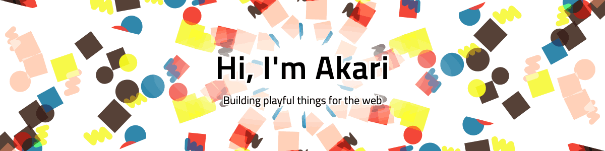

I'm Akari — I like building small, playful things for the web, these days mostly together with AI.

エンジニアの方と気軽につながれたら嬉しいです 🌱

### ✨ Featured

**[kaleidoscope](https://github.com/kawakamiakari/kaleidoscope)** — a lightweight JavaScript plugin for particle backgrounds.
The banner above is drawn with it. [Try the demo →](https://kawakamiakari.github.io/kaleidoscope/)

### 🔭 Now

- Bringing kaleidoscope back to life: TypeScript, custom SVG shapes, v2.2 just shipped
- Rebuilding my personal website from scratch

### 💬 Say hi

Issues, PRs, or just a hello on X — all welcome.
